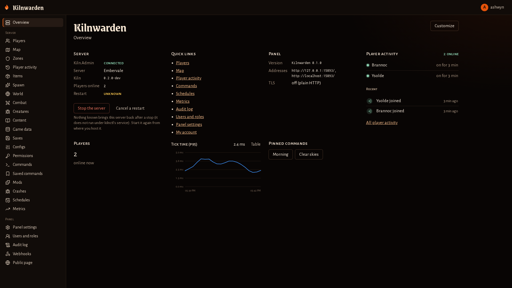
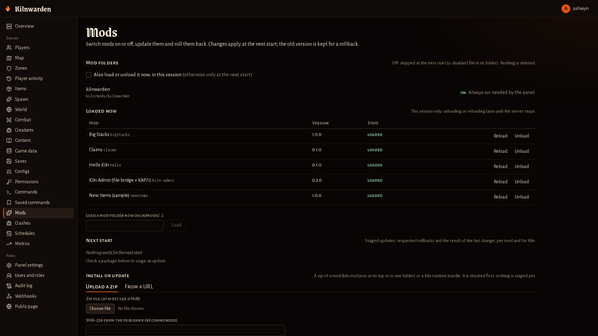
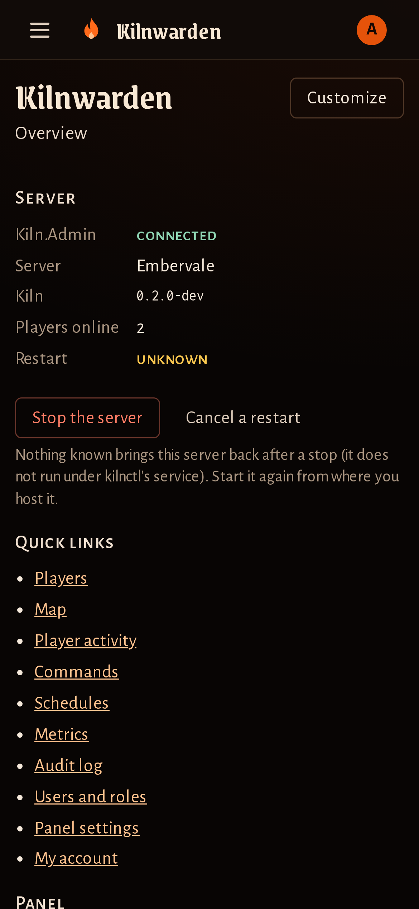
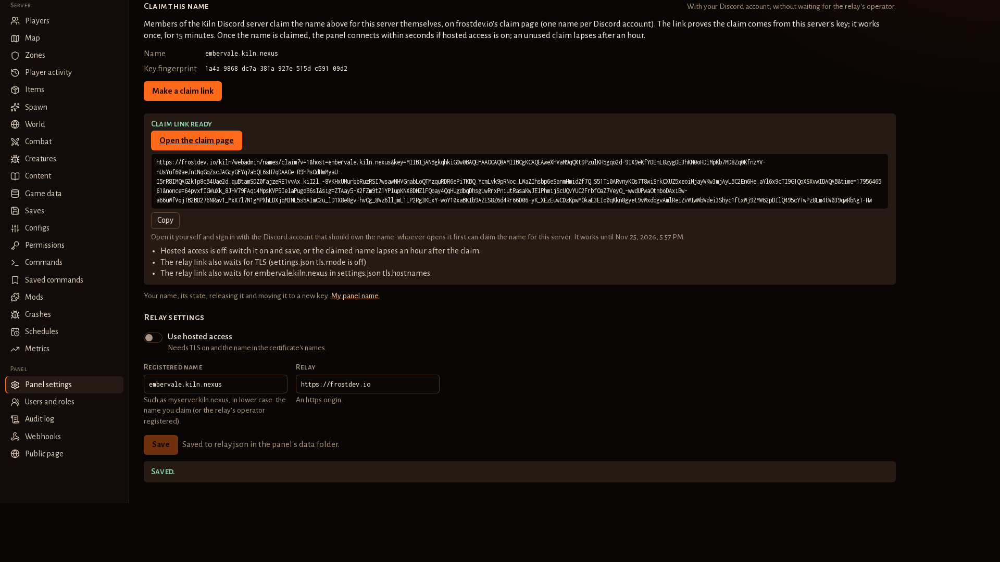

# Kilnwarden

**A web admin panel for your Enshrouded dedicated server**, as a [Kiln](https://github.com/frostdev-ops/kiln) mod. Run
your server from any browser, on a phone or a desktop. Players join with an unmodded game.

## Quick start

You need [Kiln](https://github.com/frostdev-ops/kiln) 0.2.0-dev.31.10 or later on the server.

1. Stop the server.
2. Unzip `kilnwarden-<version>.zip` into the server's `kiln/mods/` folder.
3. Start the server.
4. Open the setup link from `kiln/logs/kiln.log` (it ends in `/setup#token=…`).
   No browser on the server, such as a rented one? Type `kilnwarden setup hosted <a name>` in its console instead.
5. Answer the setup's few questions. Your panel opens at `https://<name>.kiln.nexus`.

Stuck? Type `kilnwarden status` in the server console: it says what is done and what to do next.


Kilnwarden runs inside your server and serves the panel over HTTPS, with no extra program to install or keep running.
It has the same admin pages as the Kiln Launcher, plus accounts and roles, every command as a form, schedules, mod
updates, player activity, metrics, webhooks, an audit log and an optional public page.



## What you get

- **The Kiln Launcher's admin pages, in a browser:** players, the live map, zones, items, spawning, world and weather,
  combat, creatures, content, game data, saves and backups, configs, permissions and crash reports.
- **Every command as a form:** the commands of Kiln and of every mod on your server, with pickers for players and
  items, sliders for numbers, and switches and dropdowns, checked before they run. A console with completion and
  history for the rest. Save the commands you use often and pin them to the overview.
- **Player activity:** who is on and for how long, joins, leaves and deaths, and playtime per player over 7 and 30 days.
- **Schedules:** restarts with an in-game countdown, backups, announcements and saved commands. Every day at set times,
  every few hours, or once, and skipped when nobody is on if you like.
- **Mods:** switch a mod off or on for the next start, load and reload mods, and install or update them from a zip or
  a release URL. Every package is checked (SHA-256, and minisign signatures from publishers you trust), applied at the
  next start, and can be rolled back once.
- **Metrics:** players, tick and frame time, memory, CPU, GC pauses, mod faults and the time since the last save. Live,
  for 24 hours and for 30 days, with alert rules.
- **Webhooks** to Discord or any HTTPS endpoint: joins, leaves, deaths, restarts, crashes, mod faults, failed saves,
  schedule runs, metric alerts and admin actions, with your own message text.
- **Accounts and roles:** owner, admin, moderator, viewer and roles of your own, with permissions down to single
  commands. Two-factor sign-in with recovery codes, sessions you can see and end, and an audit log of every change.
  Sign in with Steam or Discord once you link your account.
- **A public page if you want one:** whether the server is up, the player count, a map with rough player dots, your
  rules and how to join. It's off until you turn it on, and each part has its own switch.
- **Your look:** your server's name, colour, logo and favicon.
- **For mod authors:** an extension API, so a mod can add its own page, buttons, overview widgets, settings and
  webhook events.

| | |
|---|---|
|  |  |
|  |  |
|  |  |

On a phone, tables become cards and the menu folds away:

<p>
  
  
</p>

The screenshots use demo data: a test server with made-up players.

## Requirements

- An Enshrouded **dedicated server** with **Kiln 0.2.0-dev.31.10 or later**, including Kiln's admin part (Kiln.Admin,
  installed by default on a server). An older Kiln refuses to load the mod.
- Windows, or Linux with Wine or Proton. The panel works the same on both.
- Players need nothing: Kilnwarden runs only on the server.
- A current browser (Chrome, Edge, Firefox or Safari) on whatever device you use to run the server.

## Install and setup, in detail

**Install.** The zip holds one folder, `kilnwarden/`: unzipped into the server's `kiln/mods/`, it is
`kiln/mods/kilnwarden/kiln.mod.json`. That is the whole install. Neither the Kiln Launcher nor `kilnctl` installs a
mod from a release URL (as of Kiln 0.2.0-dev.31.15: `kilnctl library import` takes a downloaded file, and the
launcher's catalog is Nexus Mods), so download the zip from the GitHub release or Nexus Mods and unzip it. Once
Kilnwarden runs, its own Mods page updates it (and other mods) from a release URL.

**Setup.** At its first start, `kiln/logs/kiln.log` and the server console say one thing, in three lines:

```
Kilnwarden: set up your panel (about 2 minutes).
  On this computer, open https://127.0.0.1:15737/setup#token=…
  No browser on this computer (a rented server)? In the server console, type: kilnwarden setup hosted <a name for your panel>
```

The link opens the setup wizard, one question per page:

1. **Your account:** a name and a password. There is no default password. The browser warns once about the
   connection on your own computer (the panel's first certificate is its own); that is expected there.
2. **How will you open your panel?** Hosted access at `https://<name>.kiln.nexus` is preselected: any device, nothing to
   set up on your router. Or the Kiln Launcher (Servers > your server > **Open web panel**), or your own web address
   (an open port, a domain name and a free Let's Encrypt certificate).
3. **Hosted access:** pick a name, press **Claim with Discord** (you need to be in the
   [Kiln Discord](https://discord.gg/7pjr8SMTfU)), and watch the checklist: Connected, Claimed, Secure, Ready. It takes
   a minute or two. When a step fails, the page says why and what to do.
4. Optional, each with **Skip**: **Sign in with Discord** (one button links your own Discord; your password keeps
   working), Discord sign-in for your helpers, **Add mods to your server** (upload a mod's zip or paste a link, checked
   as on the Mods page, installed at the next restart), and **Customize your dashboard** (drag the cards into order,
   switch off what you don't need).
5. The end lists what was set up and what was skipped, with where to change each later, and the address to bookmark.

The wizard comes back to where you were after a restart, and **Panel settings > Run the setup again** starts it over.
The **Kiln Launcher**'s **Open web panel** (Kiln 0.2.0-dev.31.14 or newer) opens the wizard too, signed in.

**From the server console alone** (a rented server with FTP and a web console):

1. `kilnwarden setup hosted myserver` sets everything up and answers with a claim link. Open it and claim the name
   with Discord.
2. About two minutes later, `kilnwarden setup` answers with a link to create your account at
   `https://myserver.kiln.nexus`. Open it and you are in.

`kilnwarden status` shows the checklist at any time. Without a web console, put the command in a text file and upload it
as `kiln/control/console/<anything>.cmd` over FTP; the answer appears next to it as `<anything>.result.json`.

How the console-only setup stays safe: until the owner exists, only the server console can open the panel to the
internet, for an hour at a time, through the relay only (no port opens). The account link it gives works once, for 30
minutes, and only once the name has its trusted certificate. The link in `kiln.log` never creates the account over the
internet, so a log you share for help opens nothing. Neither link is written to `kiln.log`.

## Pick your route

How you reach the panel depends on where your server runs.
[docs/hosting-routes.md](docs/hosting-routes.md) has the step-by-step guide for each route, with the log lines you
may see.

| Your server | Route | What you need |
|---|---|---|
| **Home PC or LAN** | Open it on the server's machine, or use the Kiln Launcher. For other devices at home, set the bind address and add an IP allowlist for your network. | Nothing extra; for other devices, one open port on that PC |
| **VPS or cloud machine** | The Kiln Launcher over SSH (nothing open but SSH), or your own address: open the port and get a free Let's Encrypt certificate from the panel (HTTP-01 on port 80, TLS-ALPN-01 on port 443) or use your own certificate files | SSH, or an open TCP port and a name pointing at the server (a free dynamic DNS name works) |
| **Rented game server** (FTP and a web console only) | Hosted access at `https://<name>.kiln.nexus`. With one extra port from your host: direct HTTPS with a self-signed certificate. | File access over FTP/SFTP; outbound HTTPS from the server |
| **Docker or Pterodactyl** | A published port (an allocation) with `bind` set to `0.0.0.0` inside the container, or hosted access | One more TCP port, or outbound HTTPS only; the data folder on the persistent volume |
| **Behind CGNAT, or IPv6 only** | Hosted access. With IPv6 only, a direct IPv6 address also works, but IPv4-only visitors can't reach it. | Outbound HTTPS (IPv4 or IPv6) |

The Kiln Launcher routes need Kiln 0.2.0-dev.31.14 or newer (see Install). You can also put the panel behind your own
reverse proxy: turn its TLS off and mark the proxy as trusted.

For a server you can only reach over FTP, `kilnwarden setup hosted <name>` does the whole setup from the console
(above). The older switch `"remoteSetup": true` in `kiln/data/kilnwarden/settings.json` still opens the setup page to
other machines before the owner exists; it stays off unless you turn it on.

## Security in plain words

- **No default password.** The owner account is made with a one-time setup link from the server's log or console.
- **It starts closed.** The panel listens only on the server's own machine until there is an owner and you open it up.
  Before that, only the server console's `kilnwarden setup hosted` makes it reachable, through hosted access, for an
  hour at a time, and only with the console's one-time link. A public address makes the log warn loudly.
- **Strong sign-in.** Passwords are stored as PBKDF2 hashes (600,000 rounds). Two-factor sign-in, with recovery
  codes, can be required per role. A second password or code check comes before sensitive changes.
- **Least privilege.** Each role sees and does only what it is allowed to, down to single commands. Moderators can't
  run admin commands, and the console is owner-only by default.
- **Hard to attack from a browser.** HTTPS with HSTS, a strict content security policy, SameSite cookies, Origin
  checks, rate limits and lockouts, request size and time limits, and an optional IP allowlist.
- **Everything is written down.** The audit log records every change and who made it.
- **Checked packages.** Mod packages are checked by SHA-256, and by minisign signature against keys you trust. You
  can require signatures.
- **Your data stays on your server.** Accounts, logs, metrics and settings are in `kiln/data/kilnwarden/`. Secret
  files there (accounts, sessions, keys) are written owner-only. The panel only calls out to what you turn on: Let's Encrypt,
  Steam, the Discord sign-in broker, the relay, your webhooks, and the URLs you install mods from.

Before release, the code had a security review and fuzz testing. If you find a problem, please report
it privately: see [SECURITY.md](SECURITY.md).

## Hosted access on kiln.nexus

**kiln.nexus is frostdev's own domain for Kiln. It has no affiliation with Nexus Mods (nexusmods.com).**

Hosted access gives your panel an address like `https://myserver.kiln.nexus` with no port forwarding. Your server
keeps one outbound connection to frostdev.io's relay on port 443, and the relay hands each browser connection to it.
That is what makes it work on rented game servers, behind CGNAT, with IPv6 only and in containers.

- **frostdev never decrypts your traffic.** The relay reads only the name the browser asks for and passes the
  encrypted bytes through. TLS ends inside your game server, with your panel's own Let's Encrypt certificate, whose
  key never leaves your server, so the relay has nothing to decrypt with.
- **You claim your name with Discord.** The setup wizard (or **Panel settings > Hosted access**, or the console commands
  `kilnwarden setup hosted <name>` and `kilnwarden claim`) makes a one-time claim link signed with the panel's own key. Open it on the claim pages,
  `https://claim.kiln.nexus`, sign in with a Discord account that is a member of the Kiln Discord, and claim the name.
  Each Discord account holds one name.
- **Your server can undo a move.** Moving your name to another server, or releasing it, waits 24 hours. Until then the
  name stays with your server, whose panel shows a notice with **Undo**: someone who gets into your Discord account
  can't take your name in one go.
- **What the relay sees:** the panel's name, your visitors' IP addresses, when they connect, and how much data flows.
  The relay keeps counts, not addresses. nginx in front of it records a visitor's address only when a connection
  fails, and keeps it 14 days.
- **One limit to know:** the relay's operator controls the DNS for `kiln.nexus`, so in principle it could get a
  certificate for your name. We commit not to, and the [Kiln privacy page](https://frostdev.io/kiln/privacy) says so.
  A `kiln.nexus` CAA record forbids wildcard certificates, so no single certificate can cover every panel's name.



Hosted access is live: the relay and the claim pages at `https://claim.kiln.nexus` are open, and the landing page at
`https://kiln.nexus` says what the domain is. Panels from Kilnwarden 0.1.0 work with it too; 0.1.1 adds the move
notice with Undo and links to the claim pages directly.

## Privacy

Kilnwarden keeps its data on your server. frostdev.io only takes part if you turn on hosted access or Discord sign-in.
What frostdev.io sees and keeps for them is on the Kiln privacy page:
**[frostdev.io/kiln/privacy](https://frostdev.io/kiln/privacy)**.

## For mod authors: the extension API

If your mod's admin features are commands, they already show up as forms on the Commands page: nothing to do.

For more, the panel exports `Kilnwarden.Api.dll` (its own version, 1.0.0). With it, your mod can add a page (made of
blocks, or your own script in a sandboxed frame), actions, overview widgets, typed settings, live events and webhook
events. Declare Kilnwarden as an **optional** dependency, so your mod still loads without it.

```sh
dotnet new install <this repo>/templates/kilnwarden-module
dotnet new kilnwarden-module -n Lighthouse --moduleId lighthouse --modId lighthouse-panel
```

Read [docs/extension-api.md](docs/extension-api.md) and see the sample in `samples/Kilnwarden.Sample`.

## Building from source

You need .NET 10, [Bun](https://bun.sh), Rust with `cargo-xwin` and LLVM (for the Windows TLS library), and the
`sdk/` folder of the Kiln release that `global.json` names (0.2.0-dev.31.10).

```sh
bash tools/link-sdk.sh /path/to/kiln-0.2.0-dev.31.10/sdk
bash native/kwtls/build.sh all              # the TLS library: dist/kwtls-1.0.0.dll and a host build for the tests
(cd web && bun install --frozen-lockfile && bun run build && bun run test)
dotnet test tests/Offline -c Release
dotnet build src/Kilnwarden -c Release -t:KilnPack
```

The pack writes `bin/Release/kilnwarden-<version>.zip` and prints its SHA-256. It refuses a build without the web app
or the TLS library, or with a TLS library that isn't the recorded build of its source
(`native/kwtls/windows-build.sha256`). The zip is reproducible: `tools/release/repro.sh [commit]` builds a commit twice
from clean exports and compares the bytes. Set `SOURCE_DATE_EPOCH=$(git log -1 --format=%ct)` to get the same zip.

Discord sign-in needs the broker's public keys built in: release zips from 0.1.1 on pin frostdev.io's broker. For
your own build, save `https://frostdev.io/kiln/auth/discord/keys` as a file and add
`-p:WebAdminBrokerPins=/absolute/path/to/pins.json` to the build and pack commands; without it, Discord sign-in stays
off in that build.

Other checks:
- Browser tests: `cd web && KILN_UI_WORKTREE=<a Kiln checkout> bunx playwright test` (a dev host and a mock Kiln.Admin,
  no game needed).
- Fuzzing: `dotnet run -c Release --project tests/Fuzz -- <target|all> <seconds>`.

How it's built: [DESIGN.md](DESIGN.md). What the mod sends to the relay and the sign-in broker:
[docs/protocol-relay-broker.md](docs/protocol-relay-broker.md).

## License and credits

Kilnwarden is MIT licensed: see [LICENSE](LICENSE). It includes third-party code and fonts under their own licenses,
listed in [THIRD-PARTY-NOTICES.txt](THIRD-PARTY-NOTICES.txt):

- the Kiln Launcher's admin pages (`@kiln/admin-ui`, MIT), whose live map builds on the
  [Enshrouded Interactive Map](https://github.com/nicolasferreiraxn/Enshrouded-Interactive-Map) by Nicolas Ferreira (MIT)
  and [Leaflet](https://leafletjs.com) (BSD-2);
- [rustls](https://github.com/rustls/rustls) and its dependencies for TLS;
- React, TanStack Query and Virtual, React Router, Zustand, Lucide icons and qrcode-generator;
- the Alegreya Sans, Grenze Gotisch and Inconsolata fonts (SIL Open Font License).

The map's terrain is the game's own art, so it isn't in the zip. When the Kiln Launcher runs on the server's own
computer and has made its game art, the Map page's **Copy it from the Kiln Launcher** button copies it into
`kiln/data/kilnwarden/map-assets/`. Elsewhere, copy the launcher's `admin-assets` folder's `map` and `data` there by
hand. Players, markers and zones show without it.

Made by Frostdev. Kilnwarden is unofficial and not affiliated with or endorsed by Keen Games. kiln.nexus is frostdev's
own domain and has no affiliation with Nexus Mods (nexusmods.com).
